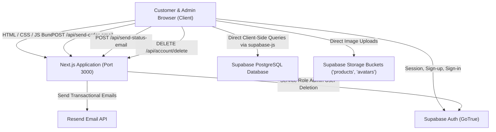

# System Architecture & Technical Design

## 1. High-Level Architecture Diagram

---

## 2. Frontend-to-Backend Communication Model

The application adopts a **Client-Heavy "BaaS" (Backend-as-a-Service) Architecture**:

1. **Direct Database Communication**:
   - The browser directly imports `@/lib/supabase` (initialized with the public Supabase Anon key).
   - CRUD operations for products, orders, cart items, wishlist, reviews, shipping rates, and user profiles are initiated directly from React Client Components.
   - **Tradeoff**: Very fast initial development and zero boilerplate API routes, but requires strict PostgreSQL **Row Level Security (RLS)** policies to prevent unauthorized data tampering.

2. **Next.js Server API Routes (Route Handlers)**:
   Used selectively for actions requiring private server-side secrets:
   - `DELETE /api/account/delete`: Uses `SUPABASE_SERVICE_ROLE_KEY` to permanently delete user auth accounts.
   - `POST /api/send-order-email`: Uses `RESEND_API_KEY` to send order confirmation emails.
   - `POST /api/send-status-email`: Uses `RESEND_API_KEY` to send order dispatch and tracking emails.

---

## 3. Page Rendering & Component Paradigm

Across the 30+ pages, the project heavily utilizes **Client-Side Rendering (CSR)** (`"use client"`):

| Component Scope | Rendering Strategy | Rationale & Characteristics |
|---|---|---|
| `app/layout.tsx` | Server Component with client wrappers | Injects root metadata, Google Geist fonts, early theme flash script, wraps application in `ThemeProvider`, `AuthProvider`, `CartProvider`, `Navbar`, and `Footer`. |
| `app/page.tsx` | Server Component assembling client blocks | Renders `Hero`, `FeaturedCategories`, `BestSellingProducts`, `WhyChoose`, and `FeaturedProducts`. |
| `app/sitemap.ts` & `app/robots.ts` | Server Route / Metadata generator | Fetches products from database at build/request time to construct XML sitemap. |
| Storefront Pages (`/collections`, `/products/[id]`, `/cart`, `/checkout`, `/orders`) | `"use client"` Client Components | Dynamic interactive state, reading Supabase auth sessions, filtering, and local storage access. |
| Admin Panel (`/admin/**`) | `"use client"` Client Components | Real-time table manipulations, modals, and client-side access control. |

---

## 4. State Management Architecture

State is distributed across four distinct mechanisms:

1. **React Context (`context/`)**:
   - `AuthContext`: Tracks current Supabase user (`User | null`), loading status, and profile synchronization.
   - `CartContext`: Loads customer cart from Supabase `cart` table, handles variant quantities (size/color), and validates against product stock in real time.
   - `ThemeContext`: Dark/light mode switching, stored in `localStorage` under `exronix-theme` and toggling the `.dark` class on `<html>`.

2. **Cross-Component Event Bus (`lib/events.ts`)**:
   - Dispatches native browser events `window.dispatchEvent(new Event("cartUpdated"))` and `"wishlistUpdated"`.
   - Used by components like `Navbar` badges to re-fetch item counts when cart or wishlist modifications occur in child modals or product detail actions.

3. **Local Storage (`window.localStorage`)**:
   - `exronix-theme`: Theme preference.
   - `exronix-buy-now`: Temporary item cache when a customer clicks "Buy Now" instead of adding to cart.
   - `exronix_recently_viewed`: Array of up to 6 recently viewed product records (`lib/recentlyViewed.ts`).
   - `exronix-categories`: **Fallback/Mock storage** used by `app/admin/categories/page.tsx` because no backend categories table is wired up.

4. **Component-Local State (`useState` / `useMemo`)**:
   - Filtering, search text, modal visibility, and checkout form inputs.

---

## 5. Media & Storage Architecture

1. **Supabase Storage Buckets**:
   - `products`: Public bucket storing uploaded product images (`lib/storageService.ts`). Filenames generated as `${Date.now()}.${ext}` under path `products/${fileName}`.
   - `avatars`: Public bucket storing user profile pictures (`lib/avatarService.ts`). Stored under `${userId}/${Date.now()}.${ext}`.
2. **Next.js Image Optimization**:
   - Configured in `next.config.ts` with `remotePatterns` pointing to the Supabase domain (`esnuavbpzjqdeiagggzd.supabase.co`).
   - Local brand images are served from `public/images/`.
